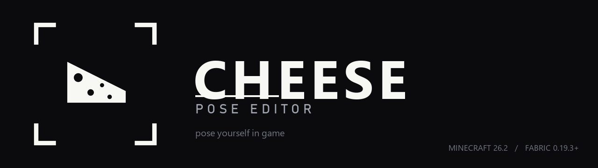
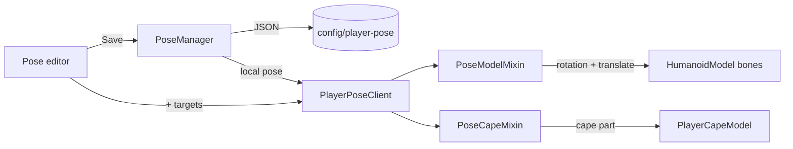

<p align="center">
  
</p>

# Cheese

**Cheese** is a client-side Fabric mod for **Minecraft 26.2** that lets you pose your
player model in game with a Blender-style bone gizmo. Pick a joint, drag a ring, save the
pose, and assign it to yourself or to other players on your client.

Everything is visual and local: poses are never sent to the server, do not move hitboxes,
and other players see their own game normally.

## Features

- **Smooth limbs** — arms and legs are built from 12 texture slices. Hips, elbows and
  knees bend along a curved centreline instead of rotating around one pivot, so the back
  edge does not fold. The torso stays rigid.
- **Bones and Poses tabs** — click the mannequin or a saved pose; the gizmo sits on the
  real joint.
- **Multi-target loading** — every pose row has a `+` button. The panel lists yourself
  and every online player; checkboxes apply immediately and support adding or removing
  targets. `Select all` flips to `Deselect all` when everyone is checked.
- **One pose per player** — checking a different pose replaces that player's previous
  pose.
- **Usage tint** — a pose row's background follows the share of online players using it:
  unused = no tint, 30% = 30% opacity, 50% = 50%, 100% = opaque.
- **Unload all** — clears your pose and every remote assignment in one click.
- **Clean start** — the panel opens on the Poses tab with nothing selected. Press **New**
  or pick a saved pose before editing.
- **New / Rename dialog** — names are entered in a modal, not by typing into a name field;
  renames are drafts until **Save**.
- **Standing check** — the panel only opens when you are standing still and upright on
  solid ground. Crawling, swimming, sneaking, sleeping, riding, climbing, water/lava and
  elytra are blocked.
- **Compatibility warnings** — the COMPAT badge lists model/animation overrides and
  explains what to disable.

## Requirements

| | |
|---|---|
| Minecraft | 26.2 |
| Fabric Loader | >= 0.19.3 |
| Fabric API | any (built against 0.158.0+26.2) |
| Java | >= 25 |

## Install

1. Install Fabric Loader for 26.2 and put [Fabric API](https://modrinth.com/mod/fabric-api)
   in `mods/`.
2. Drop `cheese-<version>.jar` into `mods/`.
3. Start the game. The mod is client-side, so it works in singleplayer and on any server
   you can join.

## Quick start

1. Stand still and upright, then press **Backspace** to open the panel. (Rebind it in
   *Options → Controls → Cheese*.)
2. The panel opens on **Poses**. Press **New** and enter a name, or click a saved pose to
   edit it.
3. Click a part on the mannequin (or press `1`–`9`), then drag a ring to rotate it. Switch
   to **Move** to drag an axis line instead.
4. Press **Save**. A new pose is not applied just by closing the editor — save first.
5. Click the **`+`** next to the pose and tick yourself and/or any online players. Each
   checkbox applies or removes the pose immediately.
6. Press **Done** or `ESC`. Remote assignments stay until you uncheck them, press
   **Unload all**, or change world/server.

A saved pose can be assigned to several players at once, but each player (including you)
carries at most one pose. Ticking a player for another pose replaces the previous one.

## Controls

| Input | Action |
|---|---|
| `Backspace` | Open/close the panel (rebindable; requires standing still and upright) |
| `Bones` / `Poses` tabs | Switch between the mannequin and the saved-pose list |
| Click a part on the mannequin | Select that bone |
| `1`–`9` | Select a bone by row (cape is click-only) |
| Click a pose row | Select it for editing (amber frame) |
| `+` on a pose row | Open the multi-target panel |
| Click the name bar | Open the Rename dialog (applied by **Save**) |
| `Save` | Write the working pose and the pending name |
| `Unload all` | Clear your pose and all remote assignments |
| `R` / `G` | Rotate / Move mode |
| Drag a coloured ring / axis line | Rotate or translate on that axis |
| Drag empty viewport space, or middle-drag | Orbit the camera |
| Scroll | Zoom the viewport, or scroll the pose list |
| `Ctrl+Z` / `Ctrl+Y` | Undo / redo (one step per drag) |
| `ESC` | Close the panel |

Red is **X**, green is **Y**, blue is **Z**. Rotations are clamped to ±180°, translations
to ±2 blocks per axis.

## What you can pose

`Body`, `Head`, left/right **upper arm** and **forearm**, left/right **upper leg** and
**shin**, and the **Cape**.

- Picking a part picks its joint. Rotations hinge where the part is attached; there is no
  separate pivot to place.
- Arms and legs are sliced into 12 segments. The hip uses a 4-unit curved band; elbows and
  knees use a symmetric band that straddles the joint (one pixel on each side), so the
  parent segment shares the bend and the inner side does not fold.
- The **cape** only appears when you wear one. Elytra use a separate model and are not
  posed.
- **Armor** uses separate single-piece limb models and does not follow a bent elbow/knee.
  Poses with bent limbs look best without armor.

## Multi-target loading

The `+` button on a saved pose opens the target panel:

- **Self** and every player in the tab list.
- Checkboxes apply immediately; there is no Apply button.
- `Select all` becomes `Deselect all` when every target has the pose.
- A player who already carries another pose is marked with `[~]` and the pose name.
  Checking the new pose replaces the old one.
- Assignments are client-side and are cleared when you change world or server.

## Usage tint

Pose rows are tinted by how many online players currently carry that pose. The online set
is you plus the tab list. Opacity is the used share: no users = no tint, 30% = 30%, 50% =
50%, 100% = fully opaque. The selected amber frame and the `+` button stay on top.

## Compatibility

The editor shows a **COMPAT** badge when something can override the rig. Hover it for the
full list.

- **EMF / OptiFine player CEM** (e.g. Fresh Animations: Player Extension) replaces the
  player model. The pose is re-applied after EMF's animation, and the pack's one-piece
  limbs bend approximately around their midpoint; disable the pack for exact elbow/knee
  bends.
- **Player Animator**, **Not Enough Animations**, **Emotecraft**, **Figura** and
  **Physics Mod** can overwrite bone rotations or replace the model.
- **Cape / wavey-cape mods** can override the cape bone.
- **3D Skin Layers** works through a compat hook, but its second-layer bending is only
  partial.
- **Sodium 0.9+** bakes entity cubes and skips the per-vertex path, which hides
  forearm/shin bends. Add `mixin.features.render.entity=false` to
  `config/sodium-mixins.properties` and restart. The editor warns when this is not set.
- **Armor and elytra** always use separate models.

## How poses are stored

Plain JSON in `config/player-pose/`, one file per pose:

```json
{
  "name": "wave",
  "skin": "Tagin_T",
  "bones": [
    { "bone": "leftArm", "x": 1.2, "y": 0.0, "z": 0.0, "tx": 0.0, "ty": 0.0, "tz": 0.0 }
  ]
}
```

- `x/y/z` are rotations in radians; `tx/ty/tz` are translations in model units (16 units =
  1 block).
- The cape's rest rotation is 180° around Y; a cape pose's `y` is added to that, so `0`
  keeps it hanging normally.
- `skin` is the local binding used when picking the pose for a skin. Remote targets are
  tracked per player UUID for the current session; they are not saved to disk.
- Each player carries at most one pose. The local active pose and the remote map are
  separate, so assigning a pose to another player does not unbind yours.
- Files are read at startup and written on save, so saved poses survive restarts.
- Plain ASCII names keep their name as the file name; other names get a readable stem plus
  a short hash (e.g. `挥手~bc5f31b3.json`), so non-ASCII names cannot overwrite each
  other. The `name` inside the file is unchanged.

## Diagnostics

The mod writes `config/player-pose/player-pose.log` with load/bind/apply decisions and a
state dump of all poses. Useful when a pose is not the one you expected:

```
[00:51:22 INFO] bind: 'Steve' -> 'bbb'; unbound [aaa]
[00:51:22 INFO] save: 'bbb' skin='Steve' bones=3
[00:51:22 INFO] apply: 'bbb' (active pose)
```

## Building

```bash
./gradlew build          # -> build/libs/cheese-<version>.jar
```

Java 25 is required. The first build resolves Minecraft, mappings and Fabric Loom from the
network; later builds work offline (`--offline`).

## How it works



The editor renders your real player model through the same GUI entity path as the
inventory screen. The gizmo uses the live `ModelPart` pivots published by the mixins.
`JointBend` moves cross-sections along a curved centreline for the hip, elbow and knee;
`PoseLimbSplitMixin` builds the 12 slices, and the render mixin applies the per-player
pose. Remote targets are resolved by UUID on each frame, so other players on your client
can carry different poses.

## Notes

- **Open Panel** defaults to **Backspace**; rebind under *Controls → Cheese*.
- This is a visual, client-side mod: poses do not move hitboxes and are invisible to other
  players' clients.
- Saved poses are matched by player name for the local skin binding; remote assignments use
  UUIDs and last for the session.
- Armor and elytra are separate models; see
  [What you can pose](#what-you-can-pose).

## License

MIT — see [LICENSE](LICENSE).
