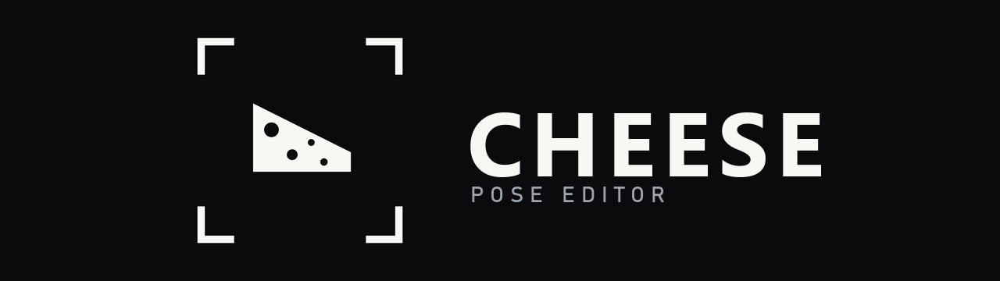
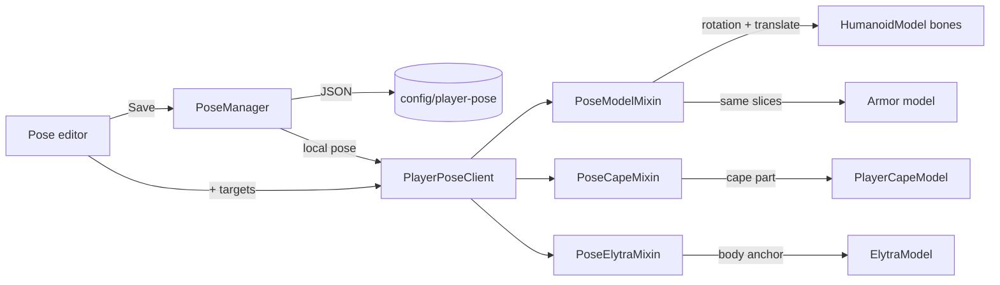

<p align="center">
  
</p>

# Cheese

**Cheese** is a client-side Fabric mod for **Minecraft 1.21.11** that lets you pose your
player model in game with a Blender-style bone gizmo. Pick a joint, drag a ring, save the
pose, and assign it to yourself or to other players on your client.

Everything is visual and local: poses are never sent to the server, do not move hitboxes,
and other players see their own game normally.

## Supported versions

One jar covers one compatibility group. Use the jar that matches your Minecraft version.

| Minecraft | Branch | Jar |
|---|---|---|
| 26.2 | `26.2/stable` | `cheese-2.2.0-26.2.jar` |
| 26.1.x | `26.1/stable` | `cheese-2.2.0-26.1.x.jar` |
| 1.21.9-1.21.11 | `1.21.11/stable` | `cheese-2.2.0-1.21.9-1.21.11.jar` |
| 1.21.6-1.21.8 | `1.21.8/stable` | `cheese-2.2.0-beta-1.21.6-1.21.8.jar` |
| 1.21.5 | `1.21.5/stable` | `cheese-2.2.0-beta-1.21.5.jar` |
| 1.21.4 | `1.21.4/stable` | `cheese-2.2.0-beta-1.21.4.jar` |
| 1.21.2-1.21.3 | `1.21.3/stable` | `cheese-2.2.0-beta-1.21.2-1.21.3.jar` |
| 1.21-1.21.1 | `1.21.1/stable` | `cheese-2.2.0-beta-1.21-1.21.1.jar` |
| 1.20.5-1.20.6 | `1.20.6/stable` | `cheese-2.2.0-beta-1.20.5-1.20.6.jar` |
| 1.20.3-1.20.4 | `1.20.4/stable` | `cheese-2.2.0-beta-1.20.3-1.20.4.jar` |
| 1.20.2 | `1.20.2/stable` | `cheese-2.2.0-beta-1.20.2.jar` |
| 1.20-1.20.1 | `1.20.1/stable` | `cheese-2.2.0-beta-1.20-1.20.1.jar` |

`main` tracks the latest line (currently 1.21.11). Repository branches and release
rules are documented in `docs/repository-layout.md` and `docs/versioning.md`.

## Features

- **Smooth limbs** — arms and legs are built from 12 texture slices. Hips, elbows and
  knees bend along a curved centreline instead of rotating around one pivot, so the back
  edge does not fold. The torso stays rigid.
- **Gear follows the pose** — armor uses the same 12-slice limbs as the skin, and elytra
  ride the posed torso instead of hanging straight.
- **Bones and Poses tabs** — click the mannequin or a saved pose; the gizmo sits on the
  real joint.
- **Multi-target loading** — every pose row has a `+` button. The panel lists yourself
  and every online player; checkboxes apply immediately and support adding or removing
  targets. `Select all` flips to `Deselect all` when everyone is checked.
- **One pose per player** — checking a different pose replaces that player's previous
  pose.
- **Usage tint** — a pose row's background follows the share of online players using it:
  unused = no tint, 30% = 30% opacity, 50% = 50%, 100% = opaque.
- **Unload all** — clears your pose and every remote assignment in one click.
- **Preview skin** — the Skin button at the top-right of the viewport loads a Mojang
  player's skin or a local PNG (64x64, or legacy 64x32). It is editor-only, supports
  Classic/Slim and has an Original skin button.
- **Clean start** — the panel opens on the Poses tab with nothing selected. Press **New**
  or pick a saved pose before editing.
- **New / Rename dialog** — names are entered in a modal, not by typing into a name field;
  renames are drafts until **Save**.
- **Standing check** — the panel only opens when you are standing still and upright on
  solid ground. Crawling, swimming, sneaking, sleeping, riding, climbing, water/lava and
  elytra are blocked.
- **Compatibility warnings** — the COMPAT badge lists model/animation overrides and
  explains what to disable.

## Requirements

| | |
|---|---|
| Minecraft | 1.21.11 |
| Fabric Loader | >= 0.20.1 |
| Fabric API | any (built against 0.141.6+1.21.11) |
| Java | >= 21 |

## Install

1. Install Fabric Loader for 1.21.11 and put [Fabric API](https://modrinth.com/mod/fabric-api)
   in `mods/`.
2. Drop `cheese-<version>.jar` into `mods/`.
3. Start the game. The mod is client-side, so it works in singleplayer and on any server
   you can join.

## Quick start

1. Stand still and upright, then press **Backspace** to open the panel. (Rebind it in
   *Options → Controls → Cheese*.)
2. The panel opens on **Poses**. Press **New** and enter a name, or click a saved pose to
   edit it.
3. Click a part on the mannequin (or press `1`–`9`), then drag a ring to rotate it. Switch
   to **Move** to drag an axis line instead.
4. Press **Save**. A new pose is not applied just by closing the editor — save first.
5. Click the **`+`** next to the pose and tick yourself and/or any online players. Each
   checkbox applies or removes the pose immediately.
6. Press **Done** or `ESC`. Remote assignments stay until you uncheck them, press
   **Unload all**, or change world/server.

A saved pose can be assigned to several players at once, but each player (including you)
carries at most one pose. Ticking a player for another pose replaces the previous one.

## Controls

| Input | Action |
|---|---|
| `Backspace` | Open/close the panel (rebindable; requires standing still and upright) |
| `Bones` / `Poses` tabs | Switch between the mannequin and the saved-pose list |
| Click a part on the mannequin | Select that bone |
| `1`–`9` | Select a bone by row (cape is click-only) |
| Click a pose row | Select it for editing (amber frame) |
| `+` on a pose row | Open the multi-target panel |
| Click the name bar | Open the Rename dialog (applied by **Save**) |
| `Save` | Write the working pose and the pending name |
| `Unload all` | Clear your pose and all remote assignments |
| `R` / `G` | Rotate / Move mode |
| Drag a coloured ring / axis line | Rotate or translate on that axis |
| Drag empty viewport space, or middle-drag | Orbit the camera |
| Scroll | Zoom the viewport, or scroll the pose list |
| `Ctrl+Z` / `Ctrl+Y` | Undo / redo (one step per drag) |
| `ESC` | Close the panel |

Red is **X**, green is **Y**, blue is **Z**. Rotations are clamped to ±180°, translations
to ±2 blocks per axis.

## What you can pose

`Body`, `Head`, left/right **upper arm** and **forearm**, left/right **upper leg** and
**shin**, plus **Cape / Elytra** (one click-only chip under the mannequin).

- Picking a part picks its joint. Rotations hinge where the part is attached; there is no
  separate pivot to place.
- Arms and legs are sliced into 12 segments. The hip uses a 4-unit curved band; elbows and
  knees use a symmetric band that straddles the joint (one pixel on each side), so the
  parent segment shares the bend and the inner side does not fold.
- **Cape / Elytra** is one bone: a player can never wear both, so the editor drives the
  model that is actually on your back and the chip/label switches between "Cape" and
  "Elytra" by itself. If you own no cape, a **Demo** chip appears left of it and puts a
  bundled cape on the preview; click it again to go back. In elytra mode an **Elytra
  Control** panel at the top-left of the viewport has three vertical sliders for the
  opening angles around X, Y and Z (X is centred so it can go negative). Click its caption
  to fold the panel away; it starts open.
- **Armor** is sliced exactly like the skin. Chestplates, leggings and boots bend with the
  elbow and knee instead of staying a straight box, and they use the armor texture as-is.

## Multi-target loading

The `+` button on a saved pose opens the target panel:

- **Self** and every player in the tab list.
- Checkboxes apply immediately; there is no Apply button.
- `Select all` becomes `Deselect all` when every target has the pose.
- A player who already carries another pose is marked with `[~]` and the pose name.
  Checking the new pose replaces the old one.
- Assignments are client-side and are cleared when you change world or server.

## Usage tint

Pose rows are tinted by how many online players currently carry that pose. The online set
is you plus the tab list. Opacity is the used share: no users = no tint, 30% = 30%, 50% =
50%, 100% = fully opaque. The selected amber frame and the `+` button stay on top.

## Preview skin

The **Skin** button in the top-right of the viewport changes only the model in the
editor:

- The header has **Skin / Cape** tabs. The Skin tab loads a body skin; the Cape tab
  previews back gear without touching your account.
- On the Cape tab, pick one of the bundled official capes (Migrator, Mojang, Vanilla,
  MINECON, Cherry Blossom, Purple Heart, and more) or **Import file** to load any 64x32
  cape PNG. **Original cape** goes back to your real cape.
- A small front view beside the list shows the picked cape.
- One input field with a **Player / File** pair (same style as Rotate / Move) beside it.
  The active mode is highlighted and switching clears the field.
- In Player mode, type a Mojang name and press **Load** (or Enter). That player's cape and
  elytra textures come along too, so the back of the preview matches their skin; if they
  have no cape the preview stays capless instead of borrowing yours.
- In File mode, paste a path or press **Browse**, then **Load**. Modern 64x64 skins and
  legacy 64x32 skins both work; legacy skins are expanded so both arms and legs render.
- The field has no length limit, and a pasted path (a separator or `.png`) is loaded as a
  file even if the switch still shows Player.
- **Arms: Classic / Slim** switches the model used for a local file.
- **Original skin** restores your real skin.

The preview never changes your actual player skin, the entity, or anything sent to the
server. It is cleared when you close the editor.

## Eyelids

The **Eyes** button at the top-left of the Bones tab opens an editor-only eyelid panel. It
never changes your real skin, the entity or anything sent to the server.

- Two sliders, **L Eye** and **R Eye**. 100% is open, 0% is closed, and the eyelids are
  real geometry on the model, so they work in every camera angle.
- A slider only lights up when the loaded preview skin carries blink pixels for the
  selected format; the status beside it reads `blink` or `no pixels`.
- With no blink pixels the panel offers the bundled demo skin instead of doing nothing.

| Format | What the skin has to contain |
|---|---|
| **SkinSpice** | Control pixel `#00C0FF` at `[0,0]`, a closed-eye copy of the face at `[24,0]`-`[31,7]`, and the same copy for the hat layer at `[56,0]`-`[63,7]` when the skin has an overlay |
| **Just Expressions** | A small stack of eye frames in a spare head corner, usually `[24,0]`-`[31,7]` and sometimes the hat corner `[56,0]`-`[63,7]`. One row per blink phase (lash, half closed, open), both eyes side by side and mirrored. The eye boxes themselves are matched on the face, so the lids follow whatever eye position the artist used |

Notes:

- The two formats share the same spare corner, so a skin is one or the other. SkinSpice is
  recognised by its control pixel and wins when both could apply.
- The eyelid colour is the closed-frame colour from the skin, so a dark face gets dark
  lids. Use a skin with a lighter lash colour if you need the closed eye to stand out.
- Eye animation packs (EMF + Just Expressions/Fresh Moves) draw their own eyes; the panel
  warns that the pack may override the preview.
- **Load demo skin** swaps in the bundled sample, which carries both layouts so either
  format can be tried. While the demo is loaded the same button becomes **Original skin**
  and puts your own skin back.

## Compatibility

The editor shows a **COMPAT** badge when something can override the rig. Hover it for the
full list. Most conflicts are cosmetic; a few need a file edit, and those are the ones
nobody guesses on their own.

| Mod / feature | What you see | Fix |
|---|---|---|
| **Sodium 0.9+** | Forearm/shin bends and sliced armor stop following the pose, or look rigid | Edit `config/sodium-mixins.properties` (below) |
| **3D Skin Layers** | Hat/jacket/sleeve/pants second layer bends only partly | Expected; limit or disable those layers in its settings |
| **EMF / OptiFine player CEM** (Fresh Animations: Player Extension) | Pose applies, but one-piece limbs bend around their midpoint | Disable the pack's player model for exact elbow/knee bends |
| **Not Enough Animations** | Walking / eating / bow / third-person actions pull the arms and legs back | Stand still for a static pose, or turn those animations off |
| **Player Animator**, **Emotecraft** | Bone rotations are overridden while an emote plays | Nothing to change; the pose returns after the emote |
| **Figura** | Your avatar replaces the player model, so no pose is visible | Not compatible with a custom Figura avatar |
| **Physics Mod** | Limb or cape motion is overridden | Disable the affected physics features |
| **Cape / wavey-cape mods** | The cape bone is overridden | Disable their cape animation |
| Armor resource packs with remapped UVs | Stretched pixels on the armor limbs | Sliced armor assumes the vanilla 64x32 armor layout |

### Sodium: the switch is not in the video settings

Sodium 0.9+ bakes entity cubes and skips the per-vertex path this mod deforms. The fix is a
config file line, not a GUI option:

1. Open `config/sodium-mixins.properties` in your game directory (create the file if it is
   missing).
2. Add this line, or change the existing one:

   ```properties
   mixin.features.render.entity=false
   ```

3. Restart the game completely.

The COMPAT badge shows the same instruction while the line is missing, and the editor offers
a one-click **Sodium conflict detected** prompt on first open (once per game session; click
COMPAT to reopen it). **Fix it** writes the line for you and leaves every other Sodium
setting untouched — restart afterwards. To undo it, set the line back to `true` or delete
it and restart; the prompt links to a step-by-step restore guide.

The **Entity Culling**, **Entity Distance** and **Entity Shadows** options in Sodium's video
settings are unrelated — turning those off does nothing for this.

### 3D Skin Layers

The compat hook bends the second layer together with the limb, but only approximately: the
voxelised layer is a separate mesh, so its outer surface can separate slightly at sharp
angles. If that bothers you, disable the specific layer (hat, jacket, sleeves, pants) in
`config/skinlayers.json`.

## How poses are stored

Plain JSON in `config/player-pose/`, one file per pose:

```json
{
  "name": "wave",
  "skin": "Tagin_T",
  "bones": [
    { "bone": "leftArm", "x": 1.2, "y": 0.0, "z": 0.0, "tx": 0.0, "ty": 0.0, "tz": 0.0 }
  ]
}
```

- `x/y/z` are rotations in radians; `tx/ty/tz` are translations in model units (16 units =
  1 block).
- The cape's rest rotation is 180° around Y; a cape pose's `y` is added to that, so `0`
  keeps it hanging normally.
- `skin` is the local binding used when picking the pose for a skin. Remote targets are
  tracked per player UUID for the current session; they are not saved to disk.
- Each player carries at most one pose. The local active pose and the remote map are
  separate, so assigning a pose to another player does not unbind yours.
- Files are read at startup and written on save, so saved poses survive restarts.
- Plain ASCII names keep their name as the file name; other names get a readable stem plus
  a short hash (e.g. `挥手~bc5f31b3.json`), so non-ASCII names cannot overwrite each
  other. The `name` inside the file is unchanged.

## Diagnostics

The mod writes `config/player-pose/player-pose.log` with load/bind/apply decisions and a
state dump of all poses. Useful when a pose is not the one you expected:

```
[00:51:22 INFO] bind: 'Steve' -> 'bbb'; unbound [aaa]
[00:51:22 INFO] save: 'bbb' skin='Steve' bones=3
[00:51:22 INFO] apply: 'bbb' (active pose)
```

## Building

```bash
./gradlew build          # -> build/libs/cheese-<version>.jar
```

Java 21 is required for the 1.21.x line; 1.20.5+ also uses 21, while 1.20.1-1.20.4 use Java 17. The first build resolves Minecraft, mappings and Fabric Loom from the
network; later builds work offline (`--offline`).

## How it works



The editor renders your real player model through the same GUI entity path as the
inventory screen. The gizmo uses the live `ModelPart` pivots published by the mixins.
`JointBend` moves cross-sections along a curved centreline for the hip, elbow and knee;
`PoseLimbSplitMixin` builds the 12 slices, `PoseArmorSplitMixin` rebuilds the armor meshes
with the same slices, and the render mixin applies the per-player pose. Remote targets are
resolved by UUID on each frame, so other players on your client can carry different poses.

## Notes

- **Open Panel** defaults to **Backspace**; rebind under *Controls → Cheese*.
- This is a visual, client-side mod: poses do not move hitboxes and are invisible to other
  players' clients.
- Saved poses are matched by player name for the local skin binding; remote assignments use
  UUIDs and last for the session.
- Armor and elytra follow the pose too; see
  [What you can pose](#what-you-can-pose) and [Compatibility](#compatibility).

## License

MIT — see [LICENSE](LICENSE).

