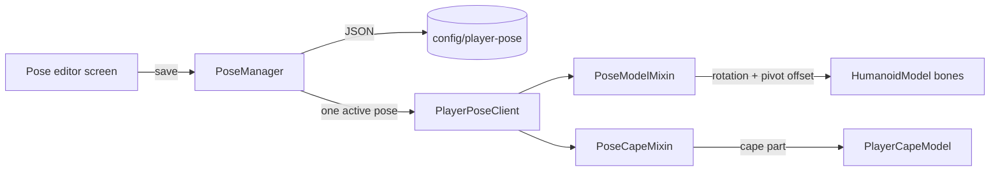

# Player Pose

A client-side Fabric mod for **Minecraft 26.2** that lets you pose your character with
Blender-style bone controls: pick a joint, drag a rotate gizmo over your own rendered
model, and save the result as a named pose.

Everything is local — poses are applied to *your* view of *your* player model, so
nothing is sent to the server and other players see you normally.

## Requirements

| | |
|---|---|
| Minecraft | 26.2 |
| Fabric Loader | >= 0.19.3 |
| Fabric API | any (built against 0.158.0+26.2) |
| Java | >= 25 |

## Install

1. Install Fabric Loader for 26.2 and put [Fabric API](https://modrinth.com/mod/fabric-api) in `mods/`.
2. Drop `player-pose-<version>.jar` into `mods/`.
3. Start the game. The mod only affects the client, so it works in singleplayer and on
   any server you can already join.

## Quick start

1. Press **`/`** in game to open the pose editor. (Rebindable in *Options → Controls →
   Player Pose*; the default clashes with vanilla's *Open Command*, see [Notes](#notes).)
2. Pick a pose in **Saved poses**, or press **New** to start a fresh one.
3. Click a part in the left list, drag a ring to rotate (or move) it.
4. Type a name and press **Save**.
5. Close the editor — **`ESC`** applies the pose to your character. Saving under a new
   name renames the pose; the old file is removed rather than duplicated.

## Controls

| Input | Action |
|---|---|
| `/` | open / close the editor (rebindable) |
| click a row, or `1`–`8` | choose what you are editing |
| `R` / `G` | **Rotate** / **Move** mode (also the two buttons) |
| drag a coloured ring | rotate, or translate along that axis |
| drag empty viewport space, or middle-drag | orbit the camera |
| scroll | zoom the viewport, or scroll the saved-pose list |
| `Ctrl+Z` / `Ctrl+Y` | undo / redo (one step per drag) |
| `ESC` | close and apply |

Red is **X**, green is **Y**, blue is **Z**. Rotation and translation range are clamped
to ±180° and ±2 blocks per axis.

## What you can pose

`Body`, `Head`, `Left Arm`, `Right Arm`, `Left Leg`, `Right Leg`, `Cape`, and the
**Cursor (pivot)**.

- The **cursor** is the point rotations happen around. Leave it at 0 and a part rotates
  about its own joint; move it and everything you rotate pivots about that point. It is
  saved with the pose.
- The **cape** is only visible if you are actually wearing a cape or an elytra — it is a
  separate model drawn by the game's cape layer.

## How poses are stored

Plain JSON in `config/player-pose/`, one file per pose:

```json
{
  "name": "wave",
  "skin": "Tagin_T",
  "bones": [
    { "bone": "leftArm", "x": 1.2, "y": 0.0, "z": 0.0, "tx": 0.0, "ty": 0.0, "tz": 0.0 }
  ],
  "cursorX": 0.0, "cursorY": 0.0, "cursorZ": 0.0
}
```

- `x/y/z` are rotations in radians, `tx/ty/tz` are translations in model units
  (16 units = 1 block). The mixin feeds them straight into Minecraft's model parts.
- `skin` binds the pose to a player name. **Only one pose is active at a time**:
  loading or saving one unbinds every other pose, so closing the editor can only ever
  apply the pose you were working on.
- Files are read at startup and written on save, so poses survive restarts.

## Diagnostics

The mod writes its own log next to the pose files:

```
config/player-pose/player-pose.log
```

It records every load, bind/unbind decision and apply, plus a state dump of all poses —
useful when a pose does not appear to be the one you loaded:

```
[00:51:22 INFO] bind: 'Steve' -> 'bbb'; unbound [aaa]
[00:51:22 INFO] save: 'bbb' skin='Steve' bones=3
[00:51:22 INFO] apply: 'bbb' (active pose)
```

## Building from source

```bash
./gradlew build          # -> build/libs/player-pose-<version>.jar
```

Java 25 is required. The first build resolves Minecraft, Mappings and Fabric Loom from
the network; later builds work offline (`--offline`).

## How it works



The editor renders your real player model through the same GUI entity path the vanilla
inventory screen uses, and the gizmo is anchored on the actual `ModelPart` pivots, which
the mixins publish as the model renders. The mixins apply rotations plus a
`cursor - R * cursor` offset, which is what turns "rotate about the joint" into "rotate
about the cursor".

## Notes

- **The default key `/` clashes with vanilla's _Open Command_.** With both bound to `/`,
  opening chat and the editor fight; rebind this mod in *Controls* if that gets in the
  way.
- This is a **visual, client-side** mod: your pose is not authoritative, does not move
  your hitbox, and is invisible to other players.
- Poses are matched by player **name**, so a pose saved for one name does not apply to
  another.
- Unknown terrain: the gizmo's vertical centring constant has been reasoned out of the
  render pipeline but not verified by eye in game.

## License

MIT — see [LICENSE](LICENSE).
