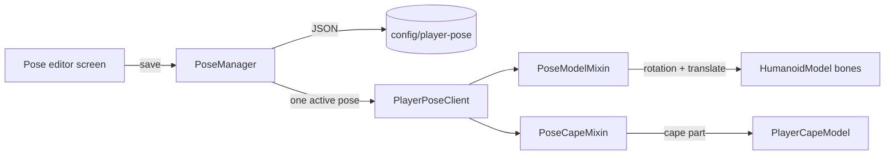

# Cheese

By **Tagin_T**. A minecraft mod that lets you pose yourself in game.

A client-side Fabric mod for **Minecraft 26.2** with Blender-style bone controls: pick a
joint, drag a rotate gizmo over your own rendered model, and save the result as a named
pose.

Everything is local — poses are applied to *your* view of *your* player model, so
nothing is sent to the server and other players see you normally.

## Requirements

| | |
|---|---|
| Minecraft | 26.2 |
| Fabric Loader | >= 0.19.3 |
| Fabric API | any (built against 0.158.0+26.2) |
| Java | >= 25 |

## Install

1. Install Fabric Loader for 26.2 and put [Fabric API](https://modrinth.com/mod/fabric-api) in `mods/`.
2. Drop `cheese-<version>.jar` into `mods/`.
3. Start the game. The mod only affects the client, so it works in singleplayer and on
   any server you can already join.

## Quick start

1. Press **`/`** in game to open the pose editor. (Rebindable in *Options → Controls →
   Player Pose*; the default clashes with vanilla's *Open Command*, see [Notes](#notes).)
2. Open the **Poses** tab and click a pose (amber frame), or press **New** to start a
   fresh one. Clicking only selects it for editing.
3. Click a part on the little mannequin in the left panel, then drag a ring to rotate
   it (or switch to Move and drag an axis line). The cape is the small button under
   the figure.
4. Type a name and press **Save**, then **Load** to put the pose on your character.
5. Close the editor — **`ESC`**. The pose marked with the blue shading stays applied.
   Saving under a new name renames the pose; the old file is removed rather than
   duplicated.

Selecting another pose does not unload the one in effect: the loaded pose keeps its
blue shading, the newly clicked one gets an amber frame. **Load** applies the framed
pose and moves the blue shading to it; **Unload** removes the pose entirely. Edits that
were not saved are not applied on close; the last saved/loaded version is.

## Controls

| Input | Action |
|---|---|
| `/` | open / close the editor (rebindable) |
| `Bones` / `Poses` tabs | switch the left panel between the mannequin and saved poses |
| click a part on the mannequin | choose what you are editing (head, torso, arms, forearms, legs, shins, cape) |
| `1`–`9` | same as clicking the mannequin (rows in the classic order; cape is click-only) |
| click a pose | select it for editing (amber frame), without unloading the blue one |
| **Load** | bind the framed pose to you and make it the active pose |
| `R` / `G` | **Rotate** / **Move** mode (also the two buttons) |
| drag a coloured ring / axis line | rotate (ring) or translate (line) along that axis |
| drag empty viewport space, or middle-drag | orbit the camera |
| scroll | zoom the viewport, or scroll the saved-pose list |
| `Ctrl+Z` / `Ctrl+Y` | undo / redo (one step per drag) |
| `ESC` | close and apply the saved pose |

Red is **X**, green is **Y**, blue is **Z**. Rotation and translation range are clamped
to ±180° and ±2 blocks per axis.

## What you can pose

`Body`, `Head`, left and right **upper arm** / **forearm**, left and right **upper leg**
/ **shin**, and the **Cape**.

- Picking a part picks its joint. Rotations always hinge where that part is attached
  (for a forearm or shin, the elbow/knee centre the limb builder marks), so there is no
  separate cursor/pivot to place. Each limb is sliced into small segments and smoothly
  skinned around the joint, so a bent arm/leg curves continuously instead of breaking
  apart.
- The **cape** is only drawn when you are actually wearing a cape; an elytra uses a
  different model and is not posed by this mod.
- Armor is rendered with separate (single-piece) arm and leg models, so it does not
  follow a bent elbow or knee. Poses with bent limbs look best without armor.

## How poses are stored

Plain JSON in `config/player-pose/`, one file per pose:

```json
{
  "name": "wave",
  "skin": "Tagin_T",
  "bones": [
    { "bone": "leftArm", "x": 1.2, "y": 0.0, "z": 0.0, "tx": 0.0, "ty": 0.0, "tz": 0.0 }
  ]
}
```

- `x/y/z` are rotations in radians, `tx/ty/tz` are translations in model units
  (16 units = 1 block). The mixin feeds them straight into Minecraft's model parts.
- The cape's rest rotation is 180° around Y; a cape pose's `y` is added to that, so
  `0` keeps the cape hanging normally.
- `skin` binds the pose to a player name. **Only one pose is loaded at a time**:
  **Load** (or the first save, when nothing is loaded yet) binds it and unbinds every
  other pose, so closing the editor can only ever apply the loaded pose. Selecting and
  saving a different pose leaves the loaded one in effect.
- Files are read at startup and written on save, so poses survive restarts.
- Plain ASCII names keep their name as the file name; other names get a readable stem
  plus a short hash (for example `挥手~bc5f31b3.json`), so two non-ASCII names can
  never overwrite each other. The `name` inside the file is unchanged.

## Diagnostics

The mod writes its own log next to the pose files:

```
config/player-pose/player-pose.log
```

It records every load, bind/unbind decision and apply, plus a state dump of all poses —
useful when a pose does not appear to be the one you loaded:

```
[00:51:22 INFO] bind: 'Steve' -> 'bbb'; unbound [aaa]
[00:51:22 INFO] save: 'bbb' skin='Steve' bones=3
[00:51:22 INFO] apply: 'bbb' (active pose)
```

## Building from source

```bash
./gradlew build          # -> build/libs/cheese-<version>.jar
```

Java 25 is required. The first build resolves Minecraft, Mappings and Fabric Loom from
the network; later builds work offline (`--offline`).

## How it works



The editor renders your real player model through the same GUI entity path the vanilla
inventory screen uses, and the gizmo is anchored on the actual `ModelPart` pivots, which
the mixins publish as the model renders. The mixins apply the bone rotation plus the
pose's `tx/ty/tz` translate offset. Each limb is built from small texture slices and
the render mixin bends their vertices around the elbow/knee with a smooth weight, so it
curves like a skinned mesh instead of breaking in two.

## Notes

- **The default key `/` clashes with vanilla's _Open Command_.** With both bound to `/`,
  opening chat and the editor fight; rebind this mod in *Controls* if that gets in the
  way.
- This is a **visual, client-side** mod: your pose is not authoritative, does not move
  your hitbox, and is invisible to other players.
- Poses are matched by player **name**, so a pose saved for one name does not apply to
  another.
- Clicking a pose in the **Poses** tab is a save, not just a preview: it binds that pose
  to your name and unbinds the previous one.
- Armor and elytra are separate models; see [What you can pose](#what-you-can-pose).
- Unknown terrain: the gizmo's vertical centring constant has been reasoned out of the
  render pipeline but not verified by eye in game.

## License

MIT — see [LICENSE](LICENSE).
